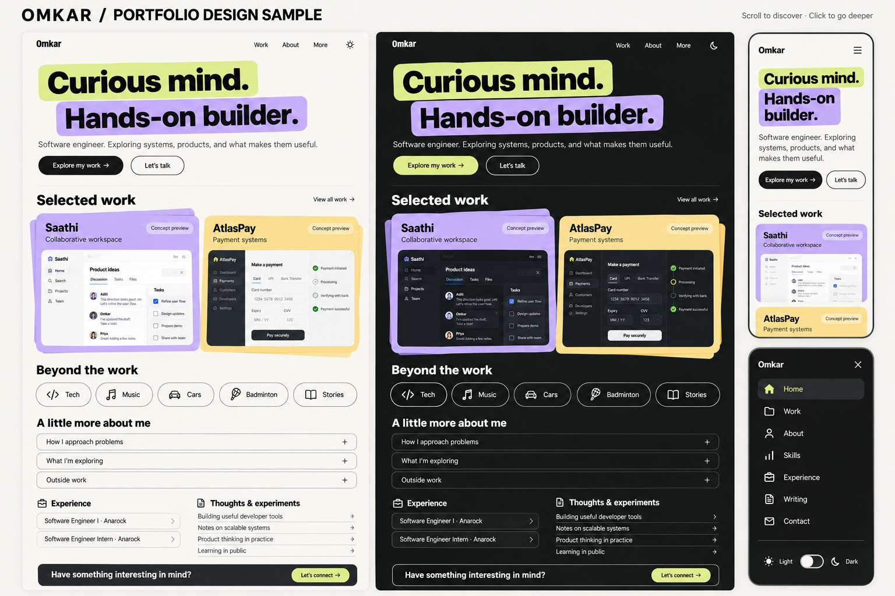

# Omkar portfolio: final design proposal

Date: 25 October 2026. Status: design ready for review; application implementation has not started. This supersedes the notebook/journal visual direction, while preserving existing content divisions and routes.

## The idea

A curious engineer you can get to know through his work. The visitor first understands who Omkar is, then discovers evidence of how he thinks and builds, then encounters the person behind it. The desired response is “I want to know more or connect.” Technical credibility and personal warmth carry equal intent, with projects providing the proof.

The visual references are [owoetoni.com](https://owoetoni.com/) for expressive typography, colorful project presentations and conversational discovery, and [Scrolltide](https://www.scrolltide.co/) for pacing. References inform composition and interaction; their artwork and proprietary components are not assets for reuse.

## Sample images

The generated board communicates composition, color and hierarchy. It is not a screenshot of implemented components. Project previews and the writing titles shown are illustrative; real project screenshots and existing article titles replace them during implementation. This document governs copy and behavior if generated text differs. No custom mascot, sticker pack or invented portrait is required. The board compresses section spacing to show the full journey; implementation uses the spacing specified below. Generated with the built-in imagegen tool; the exact prompt is saved in `portfolio-final-image-prompt.txt`.

## Visitor journey and content

| Step | Visible first | Reveal or destination |
| --- | --- | --- |
| Arrival | Name, “Curious mind. Hands-on builder.”, engineering introduction | Explore my work scrolls to projects; Let’s talk goes to Contact |
| Selected work | Saathi and AtlasPay, one clear purpose each, project preview | Open project story: problem, contribution, decisions, evidence, limits, links |
| Beyond the work | Tech, Music, Cars, Badminton, Stories | Accessible interest controls reveal existing authored content; no invented anecdotes |
| About | Brief introduction and conversational questions | Accordion reveals approach, current exploration and outside-work interests; full About remains accessible |
| Experience | Role, organization, dates and concise contribution | Existing Experience page retains Professional, Extracurricular and Achievements divisions |
| Thoughts and experiments | Writing links and a secondary AgentArena entry | Existing article/project destinations; preview dialog only where actual media exists |
| Connect | A clear invitation and direct links | Existing contact page, email and professional profiles |

Proposed hero supporting copy: “Software engineer. Exploring systems, products, and what makes them useful.” This is positioning copy, not a new career claim.

Navigation: Home, Work, About plus More on desktop; More contains Skills, Experience, Writing, Contact and résumé. Mobile uses one clearly labeled menu with all destinations. Keep the theme control directly available. A menu is a shortcut, never a prerequisite for scrolling or discovering content.

Preserve routes `/`, `/about`, `/skills`, `/projects`, `/experience`, `/blog`, `/blog/[slug]` and `/contact`. Home becomes the overview; existing pages retain depth. Browser Back, direct links and article URLs continue working. Section links use normal anchors. Project detail presentation must use existing supported destinations rather than inventing broken links.

## Assembly: existing components first

| Surface | Reuse/source | Intended behavior |
| --- | --- | --- |
| Buttons, pills, project panels | Existing Button, Badge, Card and Lucide icons | Layout and theme styling; no new general component library |
| Hero and scroll reveals | Existing FadeIn and installed framer-motion; [In View](https://motion-primitives.com/docs/in-view) as reference | Hero enters once; below-fold sections enter when visible |
| Active navigation | [Animated Background](https://motion-primitives.com/docs/animated-background), implemented with installed Motion | Small shared background follows active item; links remain native links |
| Mobile menu | Existing Sheet/Dialog and navigation links; [React Bits](https://reactbits.dev/get-started/index) Staggered Menu as visual reference | Accessible overlay with short stagger; Escape closes and focus returns |
| About questions | Existing Radix Accordion; [Disclosure](https://motion-primitives.com/docs/disclosure) as motion reference | One answer open at a time; proper expanded state and keyboard support |
| Project preview | Existing aspect-ratio, image and Dialog components | Static preview first; optional video only on explicit interaction |
| Interest controls | Existing Tabs or Accordion plus Lucide icons | Click, tap and keyboard reveal content; no drag-only information |
| Experience | Existing page content plus installed Motion | Short sequential reveal, static readable chronology underneath |
| Themes | Existing ThemeProvider, ThemeToggle and next-themes | System default plus persistent light/dark override; no flash or hydration regression |
| Contact | Existing page and form | Preserve validation, pending, success and failure behavior; API unchanged |

Motion Primitives is MIT licensed. React Bits uses MIT + Commons Clause, not plain MIT; its Pro catalog is separate. Before copying a component, record the exact source/version and retain required notices. Do not install an entire kit to reproduce an effect already supported by installed Motion. Framer remains an earlier explored alternative; this handoff targets the existing Next.js application.

Sticker Peel, draggable toolbox, custom characters and pet interactions were explored. They are omitted from this first composition because the latest instruction favors assembled existing components and no custom sticker work. The personal content still appears through interests, writing and conversational About. No copied character artwork is needed.

## Visual specification

Proposed redesign tokens, subject to review of the sample:

| Token | Light | Dark |
| --- | --- | --- |
| Canvas | #F6F5EF | #191C1A |
| Primary text | #20221F | #F6F5EF |
| Elevated surface | #FFFFFF | #252925 |
| Accent surfaces | Lime #D8ED85, violet #BDA9ED, yellow #F5D97F | Same accent families, dark ink on bright panels |

Use the existing font stack with heavy display weight and readable regular body weight. Proposed display sizing: 64–88px desktop, 40–48px mobile; body 16–18px. Content maximum width 1120px, desktop gutters 32px, mobile gutters 20px. Section spacing 80–112px desktop and 48–64px mobile. Panels use 20–24px radii; controls use pills where appropriate. Borders and typography create structure, not glow or animated backgrounds. Final contrast must be measured in the implemented states.

Desktop project panels may overlap slightly as a folder composition. Mobile panels stay in normal vertical flow. No scroll trapping, horizontal page overflow or mandatory pinned sections. Theme switching changes surfaces and text, not layout or content. Color never carries project identity or selection state alone.

## Motion storyboard

1. Arrival: headline and supporting copy enter over 300–450ms, with at most 60ms stagger. Both primary actions are immediately usable.
2. Scroll: the first project enters with 12–20px vertical movement and opacity. The next project follows naturally. A hover may lift a panel by 2–4px; tap follows the explicit action.
3. More/menu: an accessible overlay opens in about 220ms; links stagger by 30ms. Selecting a destination closes it. Focus and body-scroll restoration are mandatory.
4. About: selecting a question expands its answer in 180–250ms without moving the visitor to another page. The question retains focus.
5. Theme: colors transition briefly; no full-screen wipe or layout movement.
6. Reduced motion: remove translation, stagger and hover lift; show content immediately. No looping decoration or auto-playing sound.

These are proposed timings, not measured performance. Keep no more than one prominent motion event in a viewport. Content must remain available if animation fails or JavaScript is delayed.

## Content evidence and links

Use `public/Omkar-Jawalikar-Resume.pdf` as the résumé source; refresh dates and claims against it during implementation. Previously inspected résumé records Anarock SDE I July 2026–present, internship December 2025–June 2026. Do not take dates or metrics from generated images.

- Saathi: collaborative workspace. [Source](https://github.com/Falcon-J/saathi), [demo candidate](https://saathi-ten.vercel.app/). Explain reconnect, event replay and reconciliation accurately; do not call it offline-first editing. Previously inspected release evidence described limited beta, not full production readiness.
- AtlasPay: payment systems using Go, Kafka, PostgreSQL, Redis and Docker. [Source](https://github.com/Falcon-J/AtlasPay), [demo candidate](https://atlas-pay-two.vercel.app). Any performance figure must name its local benchmark conditions. Omit unsupported older throughput claims.
- AgentArena: secondary experiment. [Source](https://github.com/Falcon-J/deepagentarena). Refresh its current description before publishing.
- [Writing](https://medium.com/@omkarjawalikar04), [GitHub](https://github.com/Falcon-J), [LinkedIn activity](https://www.linkedin.com/in/omkar-jawalikar/recent-activity/all/).

External destination availability has not been rechecked for this document. Interests come from existing portfolio categories; private chat details do not become public copy automatically. Do not fabricate testimonials, production outcomes or usage metrics. Keep Skills categories, education and certifications available in their current pages.

## Next.js implementation boundary

Confirmed dependencies: Next.js 15.2.8, React 19, Tailwind 3, framer-motion 12.18.1, next-themes, Radix and Lucide. Existing FadeIn animates on mount rather than viewport entry and does not itself check reduced motion: adapt that responsible component when implementing the agreed reveal behavior, then check its callers. Existing ThemeToggle already has a mounted guard; preserve it.

Likely affected surfaces: home, Header/Footer, FadeIn, theme tokens and relevant page styling; existing UI primitives and navigation provide the assembly. Keep route contracts and contact handling. Preserve unrelated untracked `app/design`, docs, images and tests. Previous journal preview assets remain historical and must not silently become this redesign’s assets.

Implementation sequence after visual review: apply tokens and shared navigation; compose Home with real project media; align deeper pages and content; add focused motion using existing components; verify desktop/mobile and both themes. No deployment or commit is included.

## Acceptance and remaining checks

- At 360px, 768px and desktop widths, content is readable and no horizontal overflow or overlap blocks actions.
- All original sections and routes remain reachable; menu, anchors, project links, résumé and Back work.
- Keyboard can operate every control; menu/dialog focus is contained and restored; accordion states are announced.
- Light, dark and system themes preserve readable text, focus states and hydration behavior.
- Reduced-motion users receive the complete content without movement; hover-only previews have tap/keyboard equivalents.
- Actual project images replace conceptual previews; media is sized and deferred to avoid layout shift and unnecessary downloads.
- Contact success and failure states remain intact. Relevant lint/type/build checks run after implementation.

Current verification: inspected installed dependencies, homepage composition, FadeIn, ThemeToggle, public asset names and working-tree status. The images are generated design samples, not browser-tested layouts. No application source, contact API or deployment has changed in this design-only step.
