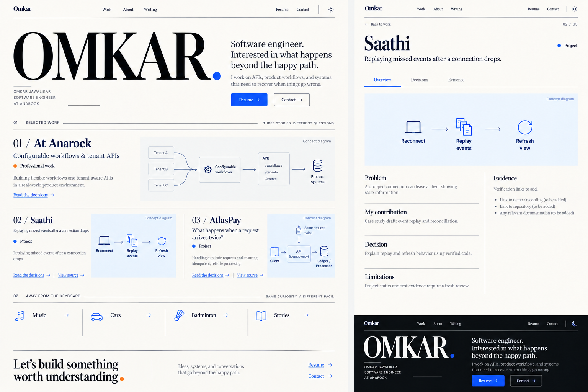
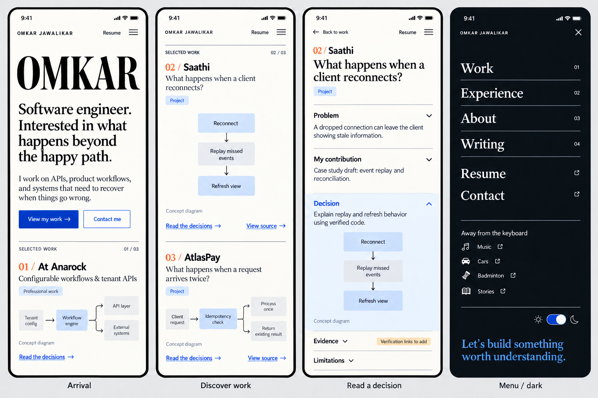

# Portfolio rethink: engineering evidence and personal identity

25 October 2026. Research and design proposal, not implementation. Supersedes the rejected `portfolio-final-design.md` direction. Target assumption: early career backend/full-stack SWE roles, including big tech; this is not a specialist graphics portfolio.

## Finding

The portfolio currently makes readers infer competence from technology names and feature claims. The next version should let them inspect a problem, Omkar's contribution, a decision, the evidence and the limits. This improves the material available to a reviewer; it cannot establish hiring readiness or guarantee an interview.

## Portfolio lists, recognition and relevance

Research used public primary pages and indexed award results. It is a focused benchmark, not an exhaustive ranking of all portfolios or an observed hiring-conversion study. The order below is our relevance ranking for this brief, not a published global ranking.

| Relevance | Portfolio | Verified source signal | What to borrow | What not to infer |
| --- | --- | --- | --- | --- |
| 1 | [Brittany Chiang](https://brittanychiang.com/) | Direct site separates role, experience, projects, résumé and writing; work links and specific contributions are visible | Clear identity, explicit contribution, linked proof, compact personal detail | Her experience or site design does not prove that copying the layout causes hiring success |
| 2 | [Josh W. Comeau](https://www.joshwcomeau.com/) | Direct site centers technical articles, interactive guides and explanations | Demonstrate thinking through one useful explanation tied to real work | A large publishing catalog is not required for an early career applicant |
| 3 | [Owoetoni](https://owoetoni.com/) | User-selected reference; inspected in the earlier browser review for project folders, conversational About and playground | Personality, discovery and distinct visual rhythm | A product/creative portfolio is not automatically the right engineering evidence model |
| 4 | [Bruno Simon](https://bruno-simon.com/) | CSSDA's [2025 winners list](https://www.cssdesignawards.com/blog/2025-website-of-the-year-winners/430/) names Best Portfolio Site; [nominee page](https://www.cssdesignawards.com/2025-woty-site.php?name=brunos-portfolio) reports 8.84 final judges score | Make the medium demonstrate the relevant craft | A 3D environment would demonstrate a different specialty from Omkar's main work |

Bruno also has [2026 Webby and People's Voice recognition for Technical Achievement](https://winners.webbyawards.com/2026/websites-and-mobile-sites/features-design/technical-achievement/370083/brunos-portfolio). CSSDA describes its categories as UI, UX and Innovation. These are presentation/technical-experience awards, not rankings of software-engineering applicants. Awwwards pages timed out in this research; no Awwwards numerical ranking is asserted. Public pages were read as content; this turn did not conduct live mobile usability or performance tests on these reference sites.

## What big tech guidance actually supports

[Microsoft technical interviewing](https://careers.microsoft.com/v2/global/en/hiring-tips/technical-interviewing) names problem solving, design, coding and testing, including boundaries and failure cases. [Amazon's software development topics](https://amazon.jobs/content/en/how-we-hire/interview-prep/software-development-topics) emphasize applying fundamentals, coding assessments and role-relevant technical preparation. These are interview guides, not portfolio scoring rubrics.

Our inference: the portfolio should supply concrete starting points for those conversations. Résumé relevance, applications/referrals, coding ability, fundamentals and role-appropriate design/behavioral preparation still need their own work. This audit does not measure Omkar's interview ability.

## Current gaps, with source evidence

| Priority | Observed gap | Evidence | Required improvement |
| --- | --- | --- | --- |
| P0 | Metrics lack context and conflict with previously reviewed evidence | `app/projects/page.tsx` claims AtlasPay ~12.5k RPM and Saathi 200+ users/~50ms | Reconcile every claim with current reproducible evidence before publishing; show workload, duration, environment and limitations |
| P0 | Broad professional scope is difficult to substantiate | `app/experience/page.tsx` says lead backend architecture for a production-grade assistant | Separate personal ownership, team context, shipped work, prototypes and proposals; reconcile with latest résumé and release records |
| P1 | Projects communicate features instead of decisions | Project data is title, tags, description, features, GitHub/live URLs; ProjectCard renders those lists | Add navigable case studies with constraints, alternatives, failure handling, evidence and limits |
| P1 | Professional work is separated from the main project story | Experience and Projects are separate routes; project list focuses on side projects | Put a concise professional contribution story on Home, linking deeper into Experience |
| P1 | Visual proof is missing in current ProjectCard | Data has placeholder image fields but ProjectCard does not render an image | Use real project captures or accurate labeled diagrams with text equivalents |
| P1 | Technologies are detached from proof | Skills page opens a category carousel with extensive lists | Attach core skills to case studies; keep complete Skills page as secondary navigation |
| P2 | Prior concept could belong to almost anyone | Generic headline and decorative cards in rejected sample | Name Omkar, current role and the problems he works on; personal details should be authored and specific |

These are presentation/evidence gaps, not claims that the engineering work does not exist. The earlier résumé/release review found richer material than the current portfolio presents. Fresh project-source and benchmark audits remain required before promoting specific results.

## What actually belongs

### First screen

Name: Omkar Jawalikar. Role: Software Engineer I at Anarock, subject to final résumé reconciliation. Proposed positioning: “Software engineer. Interested in what happens beyond the happy path.” Supporting copy: “I work on APIs, product workflows, and systems that need to recover when things go wrong.” Work, résumé and contact are immediately accessible.

This copy is a proposed positioning statement. Do not claim large-scale ownership or staff-level authority. The desired impression is a capable early career engineer who can explain and verify his work.

### Three stories

1. **At Anarock: configurable workflows and tenant APIs.** Explain an allowed, sanitized problem, exact contribution, integration constraints and known outcome. Use existing evidence for editor/KYC work. No internal screenshots, customer details or confidential code without authorization. If material cannot be shared, show a clearly labeled abstract diagram and narrower public description.
2. **Saathi: what happens when a client reconnects?** Explain replay/reconciliation and membership boundaries. Include the constraint, alternatives, relevant code/tests and a short reproducible demo. Previously reviewed status was limited beta; refresh before publication. Never rebrand it as offline-first editing.
3. **AtlasPay: what happens when a request arrives twice?** Explain the idempotency boundary, retry behavior and failure handling actually present in the repository. Include benchmark conditions and limitations only after fresh verification. Do not invent a payments outcome diagram that contradicts the code.

Each story follows: problem → ownership → decision → tradeoff → failure case → verification → limits. Link directly to the supporting file/test/report rather than only the repository root. AgentArena remains secondary until its story and evidence are refreshed.

### Human context

Keep About, Music, Cars, Badminton, Stories and existing writing. Use an authentic existing photo only after checking the correct asset; the samples omit portraits to avoid inventing one. One useful article explaining a real engineering decision is more valuable here than an empty blog archive. New article ideas are proposals, not published content. Education, certifications and full skills remain reachable but do not dominate the first screen.

## Separate desktop and mobile samples

Generated samples are visual proposals, not implemented components or evidence of behavior. Diagram previews are conceptual and must be reconciled with code. “Verification links to add” intentionally represents missing editorial work, not a live public label. Any unintended generated claims, text or diagrams are overridden by this document.

### Desktop

Use expressive typography, warm white, near-black, cobalt and a small orange accent. Put professional work first as a wide feature, then give Saathi and AtlasPay substantial story space. A case-study page supports narrative alongside a readable diagram and evidence links. A small persistent navigation provides direct Work, About, Writing, Résumé and Contact access. Keep scrolling natural. Personal content follows the substantial stories without becoming a hidden easter egg.

### Mobile

Design for 390px, check down to 360px. Identity and résumé/contact appear first; professional summary then two projects follow in one column. Use full-width explicit tap targets, not hover previews. Case study opens a dedicated route with Back, summary, contribution and expandable decisions/evidence. Diagrams become vertical or have a readable text alternative. The menu exposes all secondary routes and theme controls; it never gates the main content. Dark mode uses the same hierarchy and contrast-tested surfaces, not a different content layout.

### Interaction and assembly

Reuse installed Motion and existing Button, Card, Accordion, Sheet/Dialog, Tabs, ThemeToggle and Lucide. Section entry, active nav and accordion expansion provide sufficient motion. Use [Motion Primitives In View](https://motion-primitives.com/docs/in-view) and [Disclosure](https://motion-primitives.com/docs/disclosure) as references only where existing components need adaptation. No custom mascot, sticker system, 3D world or animation framework is needed. Reduced-motion mode shows all content immediately. Keep progressive disclosure for detail, not identity, outcomes or primary navigation.

## Highest-value work toward the hiring goal

1. Reconcile résumé/site/repository claims and deployment status. Remove untraceable numbers from public copy when implementation is authorized.
2. Produce two concise technical case studies and one professional contribution story using existing work. This is editorial verification first, not another project build.
3. Prepare reproducible evidence: setup instructions, focused tests, short demo and explicitly scoped performance report where relevant. Label unavailable evidence rather than inventing it.
4. Make the résumé and GitHub entry points consistent with the same role focus. Test every destination.
5. Prepare to discuss the stories aloud: why this solution, rejected alternative, hardest bug, result, what remains. Separately assess coding/fundamentals and role-specific interview needs; the portfolio cannot assess or replace those.

## Acceptance before implementation and publication

The desktop and mobile designs must expose identity, a substantive project and résumé without navigating an animated maze. Case studies must contain real ownership and evidence, not placeholder metrics. Preserve original routes and contact behavior. Test keyboard/focus, 360/390/768/1440 layouts, both themes, reduced motion and direct links. Check build/types and relevant regression behavior after application changes. No API change is required by this proposal.

Verified this turn: current portfolio project/experience/skills source, primary portfolio content, CSSDA/Webby recognition and Microsoft/Amazon guidance. Architect review agrees that evidence and contribution should precede decoration. Not performed: fresh underlying project audit, live portfolio browser QA, benchmark reruns or hiring-readiness assessment. Application code remains unchanged.
