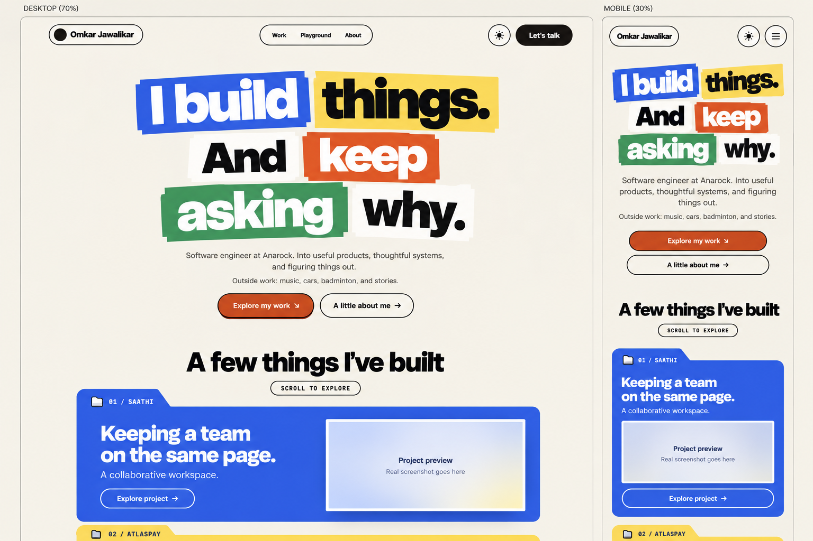

# Reference-led direction reset

User decision: stay close to Owoetoni's playful typography, lively composition and interactions, adapted to Omkar's content. This supersedes both rejected visual proposals. It does not approve the new sample or authorize deployment.

## What went wrong

The first board reduced the reference to colored cards. The second replaced the requested personality with an editorial technical résumé. Both expanded into complete screens before resolving the visual direction. Image-generated technical copy also introduced unsupported claims. This iteration intentionally tests only the opening composition and first project on desktop and mobile.

## Current sample

Reference: the previously captured and now reinspected screenshot of https://owoetoni.com/. Retain its chunky typography, centered expressive headline, warm canvas, generous section rhythm, outlined pill controls and large folder-shaped project presentations. Do not reuse its characters, awards, projects or claims. Existing components provide controls and motion; bespoke sticker art is unnecessary.

Proposed headline: “I build things. And keep asking why.” This is a copy proposal, not an approved personal quote. Follow immediately with name/current role and a short introduction. Keep the person visible through interests and About rather than exposing private chat details.

Desktop: compact three-part navigation, large central type composition, two actions, generous breathing room, then one large project folder at a time. Mobile: simpler header/menu, intentionally rewrapped type, readable body, explicit tap actions and vertically stacked project content. No desktop screenshot shrunk into a phone.

First project: Saathi, collaborative workspace. Real screenshot still needed; sample uses an honest placeholder. AtlasPay follows as a second folder. Detailed evidence, ownership and limits belong in project stories, with a short summary visible before opening. Professional experience remains in the broader content plan; this cropped sample does not represent the complete sitemap.

## Interaction proposal

- Headline word groups settle once on entry, with a short restrained stagger.
- Normal scroll reveals project folders in sequence. No scroll lock or forced navigation.
- Project title and explicit action open its story; hover is optional feedback, never required.
- Menu uses existing accessible Sheet/Dialog with staggered links, focus management and Escape close.
- About and Playground retain personal content and real experiments.
- Reduced-motion setting removes translation and stagger without hiding content.
- Light/dark both remain required. Dark theme is deferred until this composition is accepted; it will preserve the expressive accents and hierarchy.

Existing Next.js components, Motion, Radix and next-themes remain the implementation basis. No application changes in this iteration. Generated sample is not functional or browser-tested. Review this visual direction before expanding into case-study screens, full mobile flow or another final design document.

Built-in imagegen generated the sample from the inspected reference screenshot. Prompt saved alongside this document.
